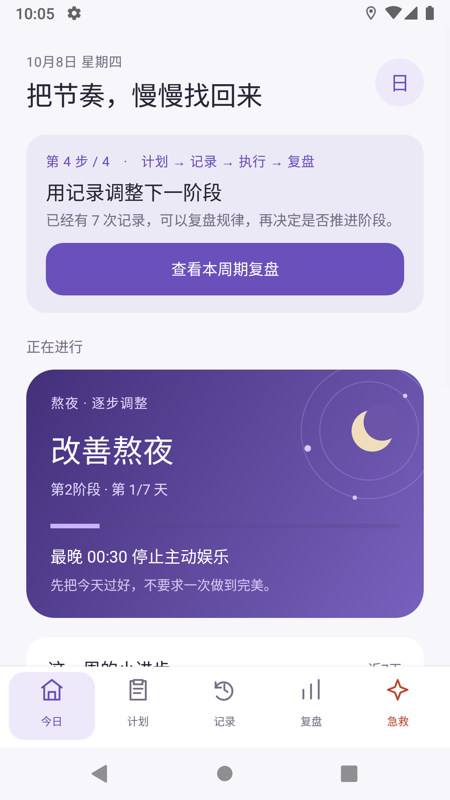
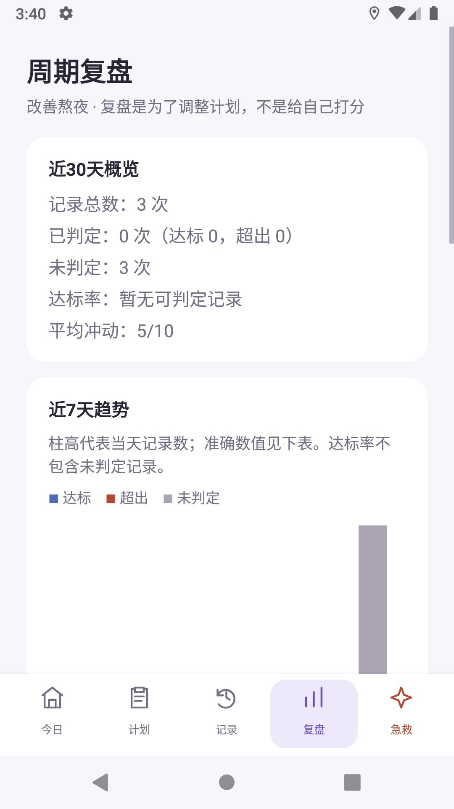
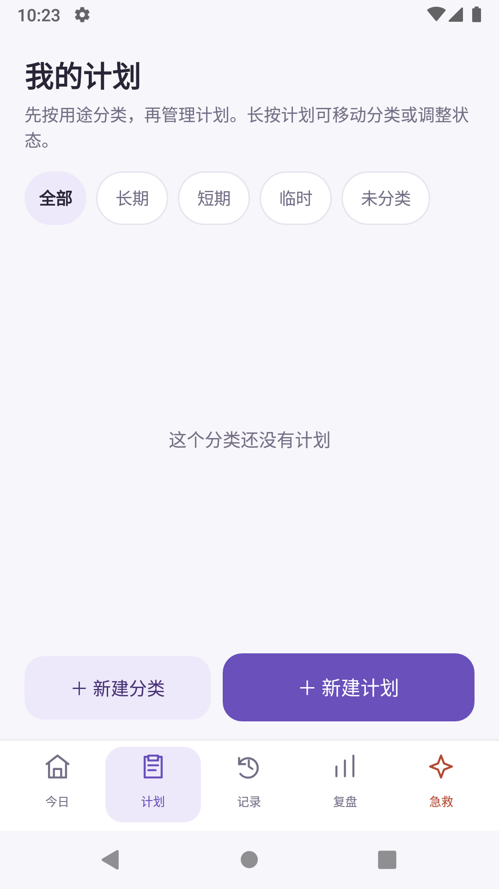
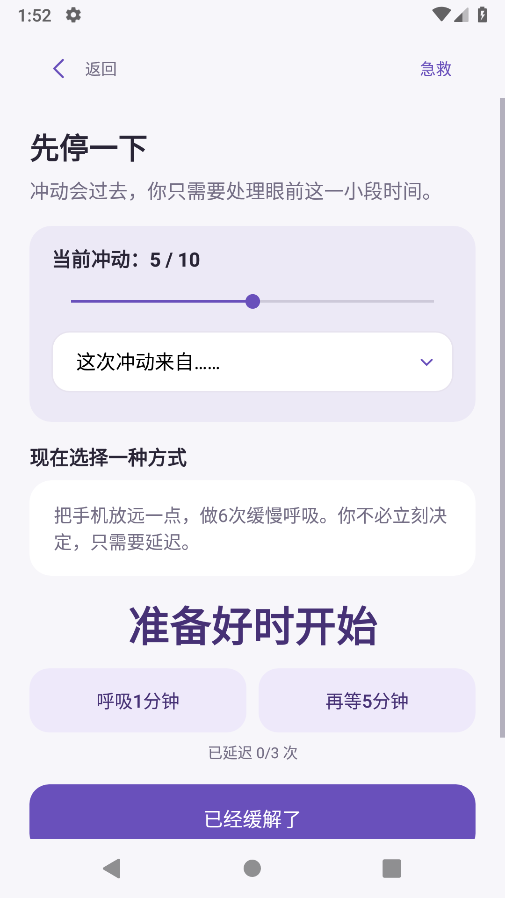

# DailyRecord · 日常记录

一款本地优先的 Android 自我管理应用，帮助用户观察、减少或停止难以控制的习惯与成瘾性行为。它强调循序渐进、非羞辱式记录和用户自主决定，不把一次偏离视为全部失败。

[下载最新测试版 APK](https://github.com/felics1/DailyRecord/releases/tag/v1.0.0-beta6) · [查看测试报告](v1.0.0-beta6_测试报告.md) · [产品交互说明](产品交互与页面规格.md)

> 当前是公开测试版，不是医疗工具。酒精、镇静药物等物质可能产生危险戒断反应，请优先咨询专业医疗人员；出现紧急危险时应立即联系当地急救服务。

## 界面预览

| 顺序引导与固定导航 | 离线统计与趋势 |
| --- | --- |
|  |  |

| 计划分类 | 冲动急救 |
| --- | --- |
|  |  |

## 已有能力

- 计划、记录、执行、复盘的四步顺序引导；
- 长期、短期、临时及自定义计划分类；
- 完全戒断、逐步调整、限量、限时和观察模式；
- 熬夜等模板生成渐进阶段，阶段由用户手动推进；
- 冲动急救、延迟计时和结果记录；
- 单条记录新增、修改、删除和提交后撤销；
- 近30天概览、近7天趋势图与逐日表格、诱因排行；
- 本地提醒、计划暂停和归档；
- Android 8.0（API 26）及以上。

## 统计规则

- 达标率只使用“达标 + 超出”的已判定记录作为分母；
- 观察期、待确认和不适用记录单列为“未判定”；
- 近期样本少于3条时不显示趋势或诱因结论；
- 图表同时提供文字图例、精确表格和无障碍朗读描述。

## 隐私与离线

- 当前版本没有 `INTERNET` 权限；
- 项目、记录、规则和冲动会话保存在本机 SQLite；
- 不读取通讯录、位置、相机或外部存储；
- 当前 APK 不含 API 密钥，未来 AI 助手也不会替代离线核心功能。

尚未完成数据库加密、应用锁、加密备份、完整无障碍专项验收和正式发布签名。测试阶段请勿录入高度敏感信息。

## 构建

需要 JDK 21 和 Android SDK。在 `android-app` 目录运行：

```powershell
.\gradlew.bat assembleDebug
```

输出：`android-app/app/build/outputs/apk/debug/app-debug.apk`

领域逻辑的轻量自检位于 `android-app/checks/RuleEvaluatorSelfCheck.java`。

## 项目结构

- `android-app/`：原生 Android Java 源码；
- `新版界面/`：当前界面截图；
- `产品交互与页面规格.md`：页面顺序与交互规则；
- `技术设计与开发任务.md`：技术边界和开发进度；
- `AI助手API接入设计_v1.md`：后续可选 AI 功能的隐私与安全方案；
- `v1.0.0-beta6_测试报告.md`：当前版本的构建、权限和模拟器验证结果。

## 当前测试版

- 版本：`1.0.0-beta6`
- APK：974,619 字节（约 0.93 MiB）
- SHA-256：`DCA4DC0D0CD4B10BD3BC1E4993AD6A6A7AB64FD1F6C7132D7DD778B6322613A9`
- 验证环境：Android 9 / API 28 模拟器
- 签名：Android 调试证书，仅用于测试

## 参与贡献

欢迎通过 Issue 提交使用问题、功能建议和统计逻辑改进。涉及医疗、隐私或数据安全的建议，请同时说明适用场景和风险。

## 许可证

[MIT License](LICENSE)
